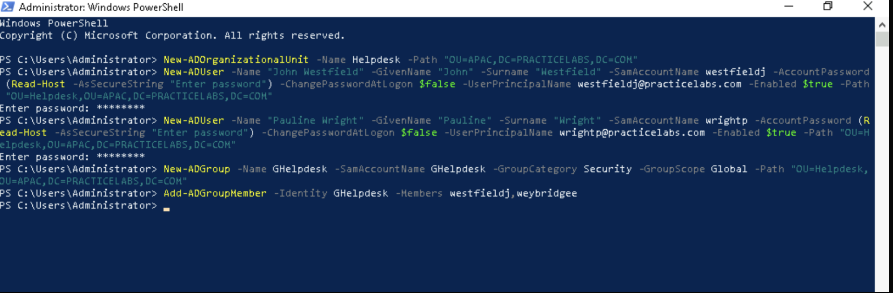
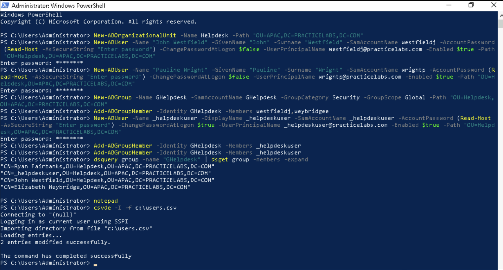

# Managing Active Directory Users with PowerShell

I used this lab to practice what happens when several people need accounts at once. I created users and security groups in PowerShell, set up a template account, then used a CSV to import users in bulk.

## What I checked

- I created accounts and groups using `New-ADUser` and `New-ADGroup`.
- I assigned group membership with `Add-ADGroupMember` and checked the results with `dsquery` and `dsget`.
- I used `csvde` to import users from a CSV file.

## 1. Creating users and security groups

I created individual accounts first so I could see which settings I needed to supply. Then I created security groups and added users to them.

## 2. Reusing a template and importing users

I set up a template user to make repeated account setup more consistent. For the bulk import, I used a CSV to supply the account details to CSVDE.

## 3. Verifying group membership

I checked the memberships from the command line after making the changes. That gave me a way to confirm where an account ended up without clicking through each user's properties.

## What I learned

Creating an account was the quick part. The part that mattered was checking that it landed in the right groups. If I did this again, I'd export the membership results after the import so I could compare them with what I expected from the CSV and the group assignments.

**Tools:** Windows Server · Active Directory · PowerShell · CSVDE · dsquery · dsget
