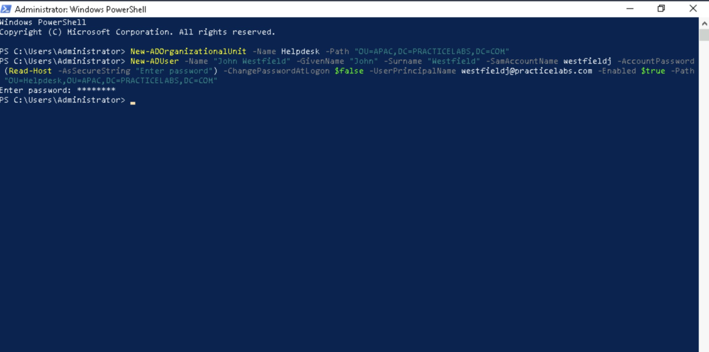
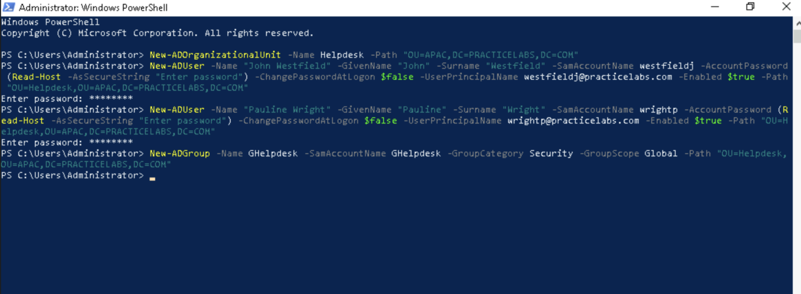
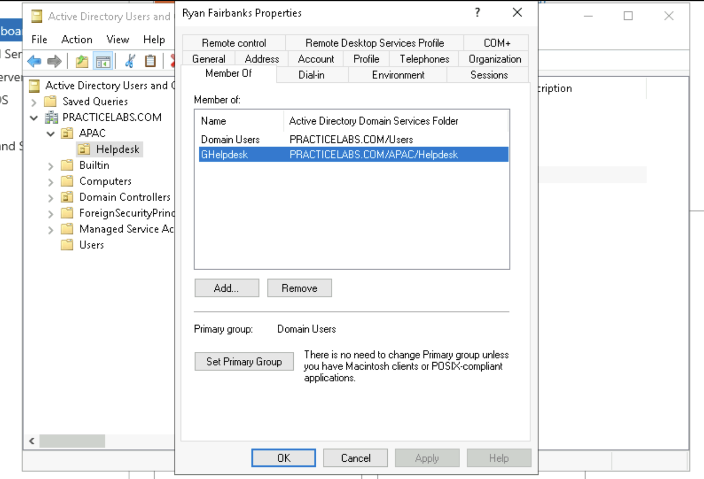
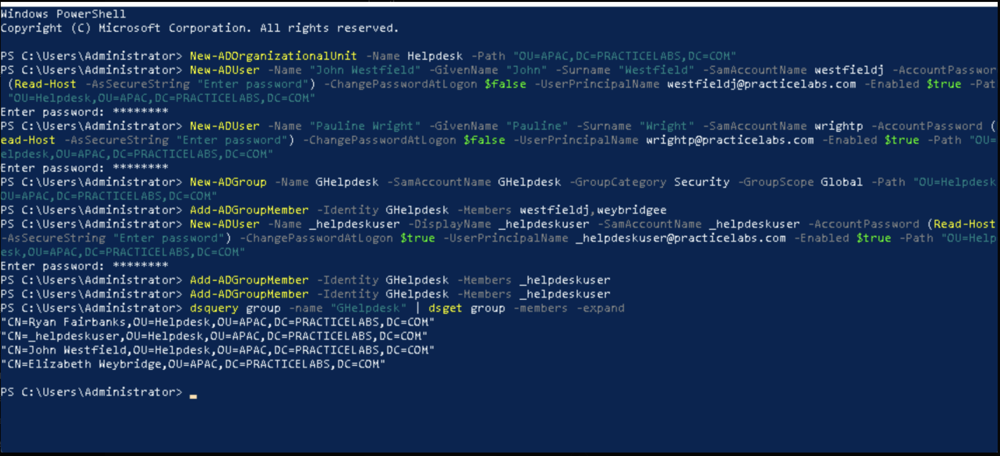

# Active Directory User Management Lab
## Project Type  
Hands-on Active Directory Lab (Practice Labs)
## Overview

This project demonstrates hands-on experience managing Active Directory users and groups using PowerShell and administrative tools in a simulated enterprise environment.

---

## Objectives

* Create and manage Active Directory users
* Create and manage security groups
* Assign group memberships
* Verify configurations using command-line tools
* Perform bulk user import operations

---

## Technologies Used

* Windows Server
* Active Directory
* PowerShell
* CSVDE

---

## Key Tasks Performed

### User Account Creation

* Created multiple users using PowerShell (New-ADUser)
* Configured usernames, passwords, and account settings

### Group Management

* Created security groups using New-ADGroup
* Added users to groups using Add-ADGroupMember

### User Templates

* Created a template user for consistent account setup
* Applied group membership automatically

### Verification

* Verified group membership using dsquery and dsget
* Confirmed correct user assignments

### Bulk User Operations

* Imported users using CSV file (csvde)
* Automated account creation process

---

## Screenshots
 

---

## Key Skills Demonstrated

## Key Skills Demonstrated  
- Active Directory Administration  
- PowerShell Scripting  
- User & Group Management  
- Identity and Access Management (IAM)  
- Bulk User Provisioning (CSVDE)  
- Command-Line Troubleshooting  

---

## Summary

This lab demonstrates the ability to manage Active Directory users, automate administrative tasks, and verify configurations in a Windows domain environment.
This project reflects practical experience performing common IT support and system administration tasks in an enterprise Active Directory environment.
